**We build the developer tools we kept wishing existed. They run on our servers or yours.**

[Website](https://wolfware.dev) · [Blog](https://wolfware.dev/blog) · [Company](https://wolfware.dev/company) · [LinkedIn](https://www.linkedin.com/company/wolfware-tech)

---

## What we make

Each product does one job and works on its own. Together they cover how software gets written,
released, run and reported on.

### Build

| Product | | |
| --- | --- | --- |
| **[Mora](https://moralang.org)** | Language | Reads like C#, manages memory without a garbage collector, compiles to one native executable. |
| **[Artic](https://artic.rs)** | UI framework | Cross-platform UI for Rust: XAML views and one GPU renderer for desktop and mobile. |
| **Doodle** | UI components | A component library on top of Artic. Open source, with a Pro edition for advanced controls. |
| **[Pavia](https://pavia.sh)** | Realtime RPC | Typed real-time RPC and messaging over WebTransport and WebSocket. |

### Ship

| Product | | |
| --- | --- | --- |
| **[Moonlit](https://moonlit.rs)** | Release automation | Build and release pipelines in YAML, with plugins that run as sandboxed WebAssembly. |

### Run

| Product | | |
| --- | --- | --- |
| **BunnyBox** | API gateway | Self-hosted API gateway and API management in a single binary. |
| **Vana** | Workflow automation | Let AI write your automations. Vana makes them safe to run. |
| **Argone** | OS / runtime | A thin layer over Linux that runs WebAssembly components as processes. |

### Report

| Product | | |
| --- | --- | --- |
| **Golden Reports** | Reporting | One report, every output: native-looking embeds, pixel-perfect PDF, Excel and labels. |

## How we license

- **Tools are fully open.** Languages, frameworks and build tooling are licensed under MIT or
  Apache-2.0. Use them anywhere, no strings.
- **Open source + Pro.** Doodle, BunnyBox, Vana and Golden Reports work on their own with the
  open-source edition. Pro adds advanced features for teams that want them.
- **SaaS or self-hosted.** Every product runs on your own infrastructure. We can host it for you
  if you'd rather not.

## Repositories

| Repository | What it is |
| --- | --- |
| [moonlit](https://github.com/wolfware-labs/moonlit) | The Moonlit engine and `moonlit` CLI |
| [moonlit-plugins](https://github.com/wolfware-labs/moonlit-plugins) | Official WebAssembly plugin components |
| [moonlit-workflows](https://github.com/wolfware-labs/moonlit-workflows) | Reusable GitHub Actions workflows for Moonlit release pipelines |
| [setup-moonlit](https://github.com/wolfware-labs/setup-moonlit) | Install the Moonlit CLI in a GitHub Actions workflow |
| [mora-lang](https://github.com/wolfware-labs/mora-lang) | The Mora language and toolchain |
| [artic](https://github.com/wolfware-labs/artic) | The Artic UI framework |
| [pavia](https://github.com/wolfware-labs/pavia) | Pavia protocol, Rust server and generated clients |
| [homebrew-tap](https://github.com/wolfware-labs/homebrew-tap) | Homebrew formulae for our tools |
| [cel-rust](https://github.com/wolfware-labs/cel-rust) | Common Expression Language interpreter in Rust |

## Who we are

Wolfware is a husband-and-wife team based in Jackson, Tennessee. Small on purpose: fewer layers,
faster decisions, and a personal commitment to every product we ship. We donate 20% of net
profit; [here's why](https://wolfware.dev/blog/company-donations).

## Get in touch

Try our tools, open an issue, or share your feedback. We read all of it.

- **Web**: [wolfware.dev](https://wolfware.dev)
- **Blog**: [wolfware.dev/blog](https://wolfware.dev/blog) for product updates and engineering notes
- **LinkedIn**: [@wolfware-tech](https://www.linkedin.com/company/wolfware-tech)

© Wolfware LLC · Jackson, TN

